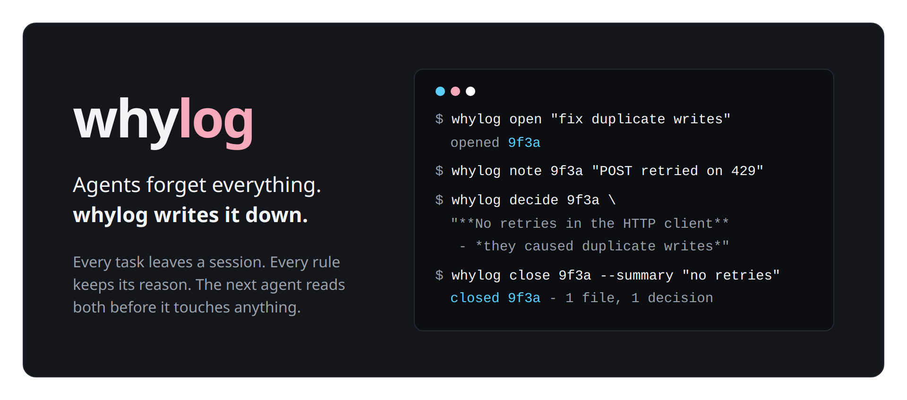
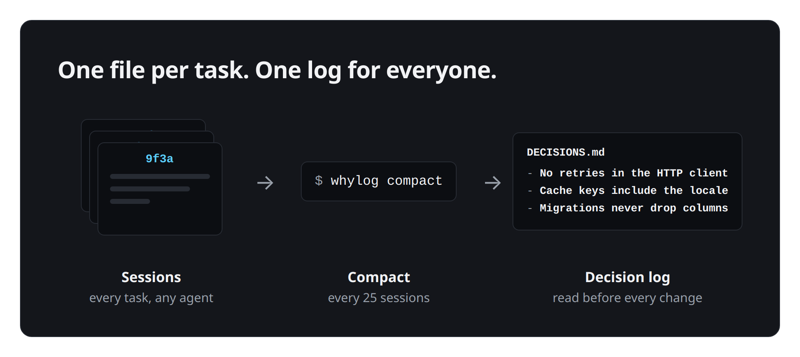
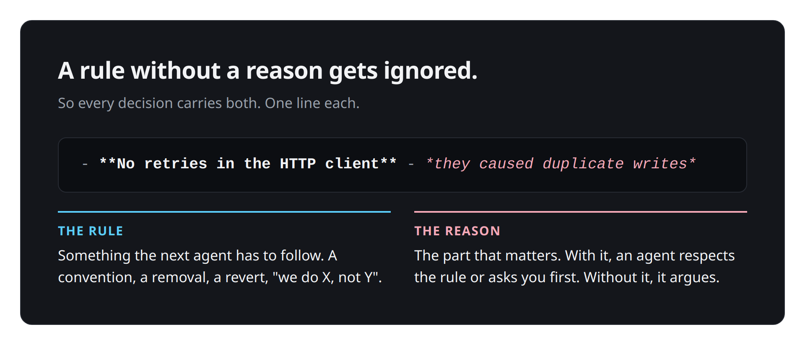

<!-- hypedoc:start -->
<!-- Generated by HypeDoc. Edit the .html sources and run `hypedoc build`; changes inside this block are overwritten. -->
<p align="center">
  
</p>
<p align="center">
  
</p>
<p align="center">
  
</p>
<!-- hypedoc:end -->

# whylog

AI agents have no memory. Every task starts from zero.

They don't know you already tried that approach and threw it away. They don't know that
weird setting is there on purpose. So they rediscover everything from scratch, or worse,
they "fix" something you broke on purpose three weeks ago.

whylog fixes that. It's a tiny CLI that keeps a record of every task done in a repo and
**why** things were decided, so the next agent (or person) actually knows what happened.

One binary. No dependencies. No API keys. Works with any agent.

## Why sessions matter

Every task gets a session. A session is a short markdown file with:

- what the task was
- what got found along the way
- what got decided
- which files changed

Before an agent starts new work, it checks what earlier sessions decided. That's it. That's
the whole trick. It stops your agents from undoing each other's work.

Over time, sessions get boiled down into one decision log. Each entry is a rule plus the
reason behind it:

```markdown
- **No automatic retries in the HTTP client** - *they caused duplicate writes.*
```

**The reason is the important part.** A rule with no reason gets ignored or argued with. A
rule with a reason gets respected, or at least challenged properly.

## Accountability for everyone

Git tells you _what_ changed. It doesn't tell you what someone was trying to do, what they
tried first, or what they decided along the way.

Sessions do. Every change has a record behind it: the task, the reasoning, the files
touched. Something broke? Find the session that touched it and read why. An agent wants to
rip out something important? The decision log tells it why it's there, so it either
respects it or asks you first.

This doesn't care who did the work. An agent, you, or a teammate. One person or ten working
at the same time. Everyone leaves the same trail.

## Install

```sh
curl -fsSL https://raw.githubusercontent.com/stuyk/whylog/main/install.sh | sh
```

Windows (PowerShell):

```powershell
irm https://raw.githubusercontent.com/stuyk/whylog/main/install.ps1 | iex
```

Builds exist for Linux, macOS and Windows on x86-64 and ARM64. Pin a version with
`WHYLOG_VERSION=0.1.0`, or build it yourself with
`cargo install --git https://github.com/stuyk/whylog`.

## Getting started

Run this once in your project:

```sh
whylog init
```

You get a `.whylog.toml` config, a `.whylog/sessions/` folder and a `DECISIONS.md` log. Want
them somewhere else? `whylog init --sessions docs/sessions --decisions docs/decisions.md`.

**`init` also writes a whylog block into your `AGENTS.md`** (and `CLAUDE.md`, unless it
already points to `AGENTS.md`). This part matters. An agent can't use whylog if it doesn't know
whylog exists, and `AGENTS.md` is the first thing every agent reads. The block tells it what
whylog is and to start every task with `whylog context`.

`whylog context` is the briefing. It tells the agent how to run a session, how to write,
what the decision log covers, and what the last few sessions did. The agent reads that and
knows exactly what to do.

The block is managed. Run `whylog agents` any time to refresh it after an upgrade, and
`whylog agents --check` in CI to fail the build if it's missing or out of date.

Then a task looks like this:

```sh
whylog why retry                         # what's already been decided?
whylog open "fix duplicate order writes" # prints a short handle like 9f3a
whylog note 9f3a "the client retried on 429 and replayed the POST"
whylog decide 9f3a "**No automatic retries in the HTTP client** - *they caused duplicate writes*"
whylog close 9f3a --summary "Removed client retries" --files src/http/client.rs
```

A note is anything worth remembering. A decision is a rule future work should follow. Only
decisions make it into the log.

Everything agents write goes through the same baseline writing rules (`whylog style`): short,
direct, active voice, real numbers, no hedging, no filler, no em-dashes. Want extra rules
for your project? Point `style_file` in `.whylog.toml` at a markdown file and they get added.

## Compacting sessions

Sessions pile up. Once 25 of them are waiting, whylog tells your agent to recommend
compacting (change the number with `compact_after` in `.whylog.toml`, or set it to 0 to turn
the reminder off). Then you boil them down:

```sh
whylog compact > digest.txt
```

That prints a short summary of every closed session that hasn't been compacted yet. Your
agent (or you) reads it and writes the decisions worth keeping into a file, one per line.
Then:

```sh
whylog compact --apply decisions.txt --through <id from the top of the digest>
```

The decisions get added to the log under a dated heading and the session files get deleted.
Open sessions, and anything that closed after the digest, are left alone. Want to keep the
files? Add `--keep`.

whylog doesn't call an AI model. **Your agent does the writing. whylog keeps the files
honest.**

## How much does this actually save?

One of my repos hit 916 sessions in four and a half months, usually with a few agents going
at once.

- All those session files together: **1.29 MB**, roughly 322k tokens. No agent is reading
  that before a task.
- The decision log that came out of it: **38 KB**, 255 lines. About 34x smaller.
- `whylog why` answers a typical question in a few hundred bytes instead of reading the
  whole log.

## Commands

| Command | What it does |
|---|---|
| `context` | The briefing an agent reads at the start of every task |
| `open <topic>` | Start a session |
| `note <id> <text>` | Add a note |
| `decide <id> <text>` | Record a decision |
| `touch <id> <files…>` | Record files you changed |
| `close <id> --summary <text>` | Finish a session (also takes `--files` and `--decision`) |
| `status`, `list`, `recent` | List sessions |
| `show <id>`, `path <id>` | Print a session file or its path |
| `why <words…>` | Search the decisions |
| `compact` | Summarize sessions ready to compact |
| `compact --apply <file> --through <id>` | Add decisions to the log, delete the compacted sessions |
| `style` | Print the writing rules agents follow |
| `agents [--check\|--remove]` | Add, refresh, check or remove the whylog block in `AGENTS.md` |
| `init`, `guide`, `skill`, `version` | Setup and help |

`<id>` is the short handle or any unique chunk of the session id. Pass `-` instead of text to
read from stdin. Most listing commands take `--json`.

## Using it with agents

`whylog init` already wired up `AGENTS.md`, so any agent that reads it is covered. For
Claude Code you can also install the skill:

```sh
whylog skill --install   # installs the Claude Code skill
whylog guide             # the full workflow, including compaction
```

## Running a bunch of agents at once

Every session is its own file, named with a timestamp and a random suffix. Run as many
agents as you want. Nothing fights over a shared file.

Every write is locked and atomic, so two agents writing at the same moment can't corrupt
anything. I tested 60 agents hammering it at once: 420 writes, zero lost.

The decision log is plain markdown, so it shows up in pull requests and gets reviewed like
any other file.

## Configuration

`.whylog.toml` sits at the root of your project:

```toml
sessions_dir = ".whylog/sessions"
decisions_file = "DECISIONS.md"
style_file = "docs/writing-style.md"   # optional, extra writing rules
compact_after = 25                     # optional, when to recommend compaction (0 = never)
```

Session files are plain markdown. Any script can read them without going through whylog.

## Releasing

```sh
git tag v1.0.2 && git push origin v1.0.2
```

The tag is the version. Pushing it kicks off a GitHub workflow that stamps the version,
tests everything, builds every platform and publishes the release. `make release V=1.0.2`
does the same and also bumps `Cargo.toml` so local builds match.

## License

MIT
